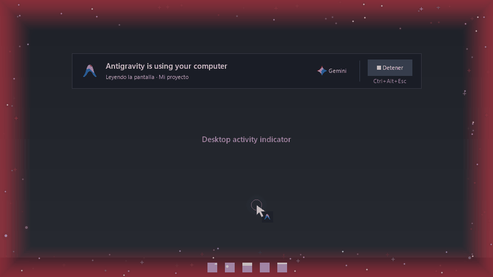

<p align="center">
  
</p>

<h1 align="center">AG Computer Use MCP</h1>

<p align="center">Control Windows applications from Antigravity chat.</p>



<p align="center">
  
  
  <a href="https://github.com/4lexxe/ag-computer-use-mcp/stargazers"></a>
</p>

An MCP server that lets Antigravity read your screen and interact with Windows applications using the mouse, keyboard and accessible UI controls.

## Features

- Capture the screen, a monitor or a specific region.
- Find and focus application windows.
- Click, type, drag, scroll and use keyboard shortcuts.
- Inspect and invoke supported Windows UI controls.
- Stop control with **Ctrl+Alt+Esc** or the **Detener** button.

## Installation

Requires **Windows 10/11**, **Python 3.11+ with Tkinter** and Antigravity or another compatible MCP client.

```powershell
git clone https://github.com/4lexxe/ag-computer-use-mcp.git
cd ag-computer-use-mcp
python -m venv .venv
.\.venv\Scripts\python.exe -m pip install .
```

## Connect to Antigravity

Add this server to your MCP configuration, usually at `%USERPROFILE%/.gemini/antigravity/mcp_config.json`. Keep any existing server entries and replace the example path with your installation's absolute path.

```json
{
  "mcpServers": {
    "windows-computer-use": {
      "command": "C:/path/to/ag-computer-use-mcp/.venv/Scripts/python.exe",
      "args": ["-m", "windows_computer_use"]
    }
  }
}
```

Save and reconnect the MCP server in Antigravity after installation or updates.

## Usage

Open an application and ask Antigravity to use the screen MCP:

```text
Use the windows-computer-use MCP to calculate 17 × 23 in Windows Calculator.
Perform the calculation in the application, verify the result on screen
and hide the indicator when finished. Do not use the terminal.
```

The indicator closes when Antigravity finishes the task. An 8-second inactivity timeout remains as a fallback. If you stop the session yourself, ask the agent to call `resume_screen_control` when you want to continue.

## Documentation

[Usage](docs/usage.md) · [Configuration example](examples/mcp_config.json) · [Contributing](CONTRIBUTING.md) · [Changelog](CHANGELOG.md) · [Third-party credits](docs/third-party.md)

Independent, unofficial project. Antigravity and Gemini names and logos belong to Google.

## ⭐ Support

If you find this useful, **[give the repository a star](https://github.com/4lexxe/ag-computer-use-mcp)**. Feedback and contributions are welcome.
